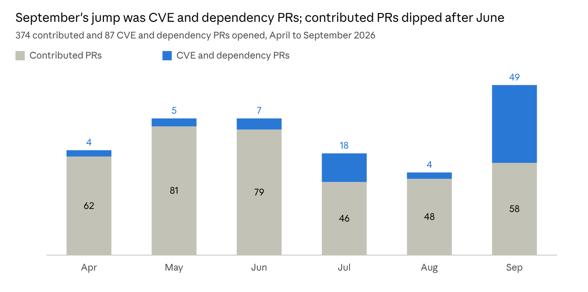

# Common Domain Model (CDM) - Semi-Annual Report, April–September 2026

15 October 2026 · Ben Page

**Reporting period:** 1 April – 30 September 2026, the six complete months before this report.

**Project Maintainers:** 14 maintainers from 6 organisations and one individual, per the [README](https://github.com/finos/common-domain-model#finos-cdm-project-maintainers):

| Organisation | Maintainers |
| --- | --- |
| ICMA | Gabriel Callsen, Tom Healey |
| ISDA | Tabish Ahmed, Eleonora Acuna, Lyteck Lynhiavu |
| ISLA | Adrian Dale, Chris Rayner |
| REGnosys | Leo Labeis, Hugo Hills, Jayasri Radhakrishnan |
| TradeHeader | Manuel Martos, Marc Gratacos |
| JPMorgan Chase & Co. | Nicholas Moger |
| Individual | Minesh Patel |

**Repository:** [finos/common-domain-model](https://github.com/finos/common-domain-model) · documentation at [cdm.finos.org](https://cdm.finos.org/)

## Project Overview

The Common Domain Model is a machine-readable and machine-executable standard for how financial products are traded and managed across the transaction lifecycle. It gives firms, platforms and regulators one representation of trades and their lifecycle events, so they can process them straight through without reconciling each other's formats.

CDM is a FINOS Graduated project and an open standard developed under the Community Specification. ISDA, ICMA and ISLA sponsor it and run working groups for their markets, and REGnosys provides the CDM Release Management Service on their behalf. The model is written in the [Rune DSL](https://github.com/finos/rune-dsl) and published as code: Java and other languages on Maven Central (`org.finos.cdm`), and Python on PyPI ([finos-cdm](https://pypi.org/project/finos-cdm/)).

The 2026 objectives, set by the Steering Working Group in the [2026 roadmap](https://github.com/finos/common-domain-model/blob/master/ROADMAP26.md), are to move the community from CDM 6 to CDM 7 in production, develop CDM 8, and extend coverage in collateral, securities lending, repo and bonds, tokenised assets, physical risk and regulatory reporting.

## Current Status

CDM 7 went into production on 17 July 2026 and CDM 8 development began four days later. Over the six months the project published 67 releases across four major versions and released 102 items of work, plus 26 CVE and dependency fixes.

**Key accomplishments**

- Released CDM 7.0.0 to production after 34 development builds in the period. The 2026 roadmap had planned it for the end of February.
- Published CDM to PyPI for the first time, as [finos-cdm](https://pypi.org/project/finos-cdm/), with Python function support ([#3239](https://github.com/finos/common-domain-model/issues/3239), [#4224](https://github.com/finos/common-domain-model/issues/4224)).
- Delivered the interest rate swap reset workflow as six composition steps, a Smart Contract Taskforce roadmap item.
- Closed 200 issues against 161 opened, cutting the open backlog by 39.
- Added multi-branch CVE scanning in August and Dependabot in September, and kept the [OpenSSF Best Practices](https://www.bestpractices.dev/projects/11267) badge at Passing.

**Major milestones achieved**

| Date | Milestone |
| --- | --- |
| Sep 2026 | Dependabot configured for automated dependency updates ([#5156](https://github.com/finos/common-domain-model/pull/5156)) |
| Aug 2026 | CVE scanning extended to the 6.x, 7.x and master branches ([#5009](https://github.com/finos/common-domain-model/pull/5009)) |
| 21 Jul 2026 | CDM 8 development opened with 8.0.0-dev.2 |
| 17 Jul 2026 | [CDM 7.0.0](https://github.com/finos/common-domain-model/releases/tag/7.0.0) production release; CDM 6 moved to maintenance |
| 9 Jul 2026 | Final CDM 5 release, 5.40.0; CDM 5 is now out of support |
| 22 Jun 2026 | Serialisation specification and implementation released in CDM 7 ([#3236](https://github.com/finos/common-domain-model/issues/3236), [#4746](https://github.com/finos/common-domain-model/issues/4746)) |
| 21 May 2026 | First PyPI release of finos-cdm (6.20.6) |

**New features or capabilities delivered**

- Interest rate swap resets: composition steps 1 to 6 ([#4168](https://github.com/finos/common-domain-model/issues/4168), [#4379](https://github.com/finos/common-domain-model/issues/4379), [#4389](https://github.com/finos/common-domain-model/issues/4389), [#4388](https://github.com/finos/common-domain-model/issues/4388), [#4413](https://github.com/finos/common-domain-model/issues/4413), [#4414](https://github.com/finos/common-domain-model/issues/4414)), the Instruction Composition Framework ([#4593](https://github.com/finos/common-domain-model/issues/4593)) and the Smart Contract Framework ([#4165](https://github.com/finos/common-domain-model/issues/4165)).
- Transfers: the Transfer choice type, CashFlow renamed to AssetFlow, contingent transfers, and the Transfer and AssetFlow rationalisation in CDM 8 ([#4513](https://github.com/finos/common-domain-model/issues/4513), [#4511](https://github.com/finos/common-domain-model/issues/4511), [#4392](https://github.com/finos/common-domain-model/issues/4392), [#4897](https://github.com/finos/common-domain-model/issues/4897)).
- Collateral and legal documentation: ISDA CSA and Eligible Collateral Schedule samples, a legal agreement amendment event, CSA/CTA clause enhancements and a Confirmation namespace ([#4459](https://github.com/finos/common-domain-model/issues/4459), [#4486](https://github.com/finos/common-domain-model/issues/4486), [#5079](https://github.com/finos/common-domain-model/issues/5079), [#3680](https://github.com/finos/common-domain-model/issues/3680)).
- Securities lending: GMSLA structure, pre-trade attributes and rate changes on securities lending trades ([#3967](https://github.com/finos/common-domain-model/issues/3967), [#4526](https://github.com/finos/common-domain-model/issues/4526), [#3640](https://github.com/finos/common-domain-model/issues/3640)).
- FpML ingestion: synonym mappings replaced by ingest functions, and new mappings for execution notifications, LinkId and party identifier schemes ([#4260](https://github.com/finos/common-domain-model/issues/4260), [#4774](https://github.com/finos/common-domain-model/issues/4774), [#4845](https://github.com/finos/common-domain-model/issues/4845), [#5074](https://github.com/finos/common-domain-model/issues/5074)).
- Pricing: core mathematical functions in the DSL for pricing model calculations ([#4169](https://github.com/finos/common-domain-model/issues/4169)).
- CDM 7 clean-up: Java packages renamed from `org.isda.cdm` to `org.finos.cdm`, the legacy `cdm.regulation` namespace and deprecated types removed, and schemas published at a public URL ([#4665](https://github.com/finos/common-domain-model/issues/4665), [#4664](https://github.com/finos/common-domain-model/issues/4664), [#4641](https://github.com/finos/common-domain-model/issues/4641), [#4436](https://github.com/finos/common-domain-model/issues/4436)).

## Community & Contribution Metrics

Contribution grew on the previous six months: 374 contributed PRs were opened against 293, and 161 issues against 114. CVE and dependency updates are counted separately, because Dependabot and the new CVE scans took them from 24 to 87.

*Source: GitHub pull requests on finos/common-domain-model, by month opened, 1 Apr to 30 Sep 2026. CVE and dependency updates: opened by Dependabot, labelled dependencies, titled "Bump x from a to b", or naming a CVE in the title or branch.*

| Measure | Apr–Sep 2026 | Oct 2025–Mar 2026 |
| --- | --- | --- |
| Contributed PRs opened | 374 | 293 |
| Contributed PRs merged | 215 | 167 |
| CVE and dependency PRs opened | 87 | 24 |
| CVE and dependency PRs merged | 52 | 11 |
| Issues opened | 161 | 114 |
| Issues closed | 200 | 99 |
| Approvals by maintainers with write access | 287, 59 of them on CVE and dependency PRs | 231, 16 of them on CVE and dependency PRs |
| People authoring commits | 29 | 25 |
| Stars gained | 48 (to 12 Sep) | 42 |
| Forks created | 26 | 24 |
| CRWG and Steering WG meetings | 18 | 22 |

- **Contributors (new/active):** 29 people authored commits on the default branch, 24 in Q2 and 19 in Q3. 51 GitHub accounts opened an issue or a contributed PR, and Rosetta Design raised PRs for 18 named contributors through its service account; the two groups overlap. 18 accounts made their first issue or PR in the period, 15 of them from outside REGnosys.
- **Open PRs:** 40 on 15 October 2026, 5 of them from Dependabot. Only one was opened before April.
- **Open Issues:** 97 on 15 October 2026, 31 of them opened before April.
- **Downloads/adoption:** [finos-cdm](https://pypistats.org/packages/finos-cdm) had 3,029 PyPI downloads from its first release on 21 May to 30 September, about 24 a day, mirrors excluded. The repository has 282 stars and 137 forks on 15 October. Maven Central does not publish download counts, so Java adoption is not measured here.

## Challenges & Blockers

The main pressures are the cost of supporting three release lines at once and a review load that rests on a few people.

**Technical challenges**

- Each change released to more than one major version needs its own PR per line. Extending `MasterAgreementTypeEnum` took three PRs, then three reverts and three re-commits in September.
- Some vulnerabilities in third-party libraries have no upstream fix, so they are suppressed for a fixed time and renewed until one exists (the jsoup and braces suppressions).
- Codefresh builds failed when Maven Central rate-limited or refused requests ([#4682](https://github.com/finos/common-domain-model/issues/4682), [#4927](https://github.com/finos/common-domain-model/issues/4927)); both were fixed in the period.
- CDM 7.0.0 reached production in July against an end-of-February plan. \[Maintainers to add the cause.\]

**Resource constraints**

- Four reviewers gave 222 of the 287 approvals from people with write access. 10 of the 14 named maintainers approved at least one PR.
- CVE and dependency PRs took 59 of those approvals, and 40 of the 95 in September alone.
- Contributed PRs fell from 222 opened in Q2 to 152 in Q3, after the CDM 7.0.0 release. \[Maintainers to confirm whether this is seasonal.\]

**Community or adoption barriers**

- CDM 7 renamed the Java packages from `org.isda.cdm` to `org.finos.cdm` and removed deprecated types and namespaces, so adopters must change code to upgrade, not only bump a version.
- PRs made in Rosetta Design are opened by a REGnosys service account, so PR lists show the account rather than the 18 people who contributed that way. Their commits do carry their own GitHub identities, so commit-based counts include them.
- Adoption is hard to evidence. GitHub stopped returning the list of who starred the repository and when in September, Maven Central does not publish download counts, and PyPI history starts only at the first release on 21 May.

## Roadmap & Goals for Next 6 Months

From October 2026 to March 2027 the project runs one release in each support state, as the [draft 2026/27 release schedule](https://github.com/finos/common-domain-model/blob/master/SCHEDULE26.md) sets out: CDM 7 in production, CDM 6 in maintenance and CDM 8 in development. CDM 5 is out of support. The schedule was a draft for the September Steering Working Group; whether it was ratified there is not recorded in the repository.

**Goals**

- Move adopters onto CDM 7, which went into production on 17 July 2026, and keep CDM 6 to critical fixes only.
- Keep CDM 8 development builds flowing from the main branch, with CDM 9 development not due to start until July 2027.
- Proposed, for the maintainers to confirm: keep CVE and dependency fixes flowing to all three supported lines from the multi-branch CVE scanning added in August.

**Upcoming milestones** (from the [2026 roadmap](https://github.com/finos/common-domain-model/blob/master/ROADMAP26.md))

- Q4 2026: Steering WG vote to appoint a Chair from January 2027 (nominations were due to open in September).
- Q4 2026: 2027 roadmap agreed and published by the Steering WG.
- Q4 2026 events: FINOS Workshop, ISLA Post Trade, DRR Training in New York.

**Planned features and releases**

- Contribution Review WG: Events & Positions cross-product modelling, sponsored by ISDA, and the continued managed release service.
- Collateral WG: functions for collateral workflows, the CDM Collateral handbook, and a plan for 2027 collateral extensions.
- Tokenised Assets WG: further token lifecycle events, building on the TokenisedAsset type and basic lifecycle events.
- Physical Risk WG: wider adoption and interbank and client integration.
- Technical Architecture WG: the items the Steering WG prioritised in November 2025.
- Securities Lending, Derivatives, and ICMA Repo & Bonds WGs: lifecycle contributions, product expansion for DRR, and the SFTR reporting model.
- Support: an AI assistant for documentation and user queries, planned for Q4 2026.

## TOC Support Needed

Draft asks, for the maintainers to confirm or replace: help measuring adoption, guidance on running vulnerability fixes across several release lines, and closer release coordination with Rune DSL.

**Cross-project collaboration**

- Coordination with [Rune DSL](https://github.com/finos/rune-dsl), the FINOS language CDM is written in. Every DSL update means a PR on each supported CDM line, so aligning the two projects' release cadences would cut that repeated work.
- An introduction to other FINOS projects that support several release lines at once, to share how they handle CVE and dependency fixes.

**Technical guidance**

- FINOS guidance on vulnerability management across maintained release lines, including how long a suppression may stand when no upstream fix exists.
- Advice on moving the OpenSSF Best Practices badge from Passing to Silver, which is 9% complete.

**Adoption measurement**

- Maven Central download statistics for `org.finos.cdm`, if FINOS can obtain them as the namespace owner. They would show Java adoption, which is not measured today.
- Advice on reporting adoption now that GitHub no longer returns star history.

**Lifecycle transition considerations**

- None requested. CDM is a Graduated project and expects to stay so.

## Additional Information

- **Working groups:** the project runs 11 active working groups, including ISLA's and ICMA's own CDM groups. The Contribution Review WG met 13 times and took 133 agenda items, and the Steering WG met 5 times with 24 agenda items, counted from their minutes in GitHub Discussions. The other groups' meetings are not counted here.
- **Release management:** ISDA, ICMA and ISLA commission REGnosys to run the CDM Release Management Service, which takes contributions through review and release on every supported line.
- **Training:** the Linux Foundation runs a 90-minute course, [Introduction to the CDM (LFEL1016)](https://training.linuxfoundation.org/training/introduction-to-the-common-domain-model-cdm-lfel1016/).
- **How the figures were produced:** from the GitHub API on 15 October 2026, with REGnosys's CDM metrics extract. Six-month figures cover 1 April to 30 September 2026, compared with 1 October 2025 to 31 March 2026. Stars gained use the last extract that could still read star history, taken on 15 September. Open PRs and issues, stars and forks are counts on 15 October.

## Sources

- [finos/common-domain-model README](https://github.com/finos/common-domain-model#readme): overview, governance, maintainers and working groups
- [2026 CDM Roadmap](https://github.com/finos/common-domain-model/blob/master/ROADMAP26.md) and [2026/27 release schedule](https://github.com/finos/common-domain-model/blob/master/SCHEDULE26.md)
- [CDM releases](https://github.com/finos/common-domain-model/releases)
- [OpenSSF Best Practices: common-domain-model](https://www.bestpractices.dev/projects/11267)
- [finos-cdm on PyPI](https://pypi.org/project/finos-cdm/) and [pypistats](https://pypistats.org/packages/finos-cdm)
